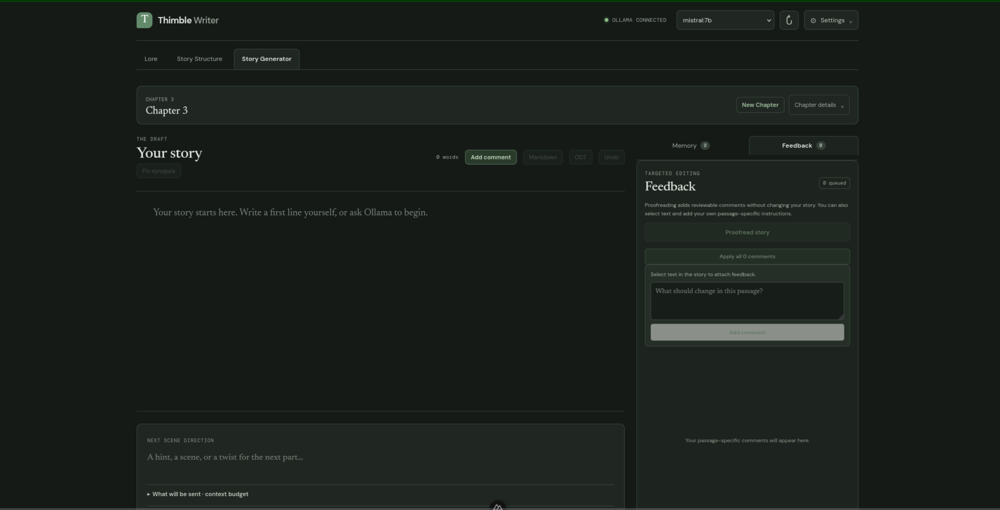

# Thimble Writer

A story-writing front end for small, locally hosted language models, built as a **proof of concept**. Inspired by perchance.org's [story writer](https://perchance.org/ai-story-generator).

It was created due to a mix of frustration with existing LLM Story Writing harnesses taking control away from the user in various niche situations (enforcing a chat-first interaction), or lacking features (in the case of perchance), or was wasting tokens for efficiency due to trying to send massive unnecessary contexts and brute force it to the large models (various commercial or open-source alternatives).



> ## ⚠️ Run locally only. Never deploy this.
>
> Thimble Writer is an **insecure proof of concept**. It has no authentication, no rate limiting, no input hardening, and has not been security reviewed. It talks to Ollama directly from the browser and keeps your work unencrypted in the browser's local storage.
>
> - **Do not host it** on a server, a public URL, a shared network, or a static-hosting service.
> - **Do not connect it to public or paid APIs.** It is built for a local Ollama server only. Putting an API key in a browser app exposes the key to everyone who can load the page.
> - **Do not expose Ollama to your network** (`OLLAMA_HOST=0.0.0.0`). Ollama has no authentication.
> - **Do not set `OLLAMA_ORIGINS="*"`.** That lets any website you visit send requests to your local Ollama.
>
> Run it on your own machine, for yourself.

## What this project is trying to show

Small language models (roughly 1B to 8B parameters) are weak at long context, staying consistent, and following many instructions at once. Asked to "write the next part of my story" with everything in one big prompt, they lose track of characters, repeat themselves, and drift.

This PoC tests a different approach: **put a harness around the model and make several small, focused passes instead of one large request.** Each pass gets only the context it needs, returns something that can be checked in code, and hands the result to the next pass. If you self-host with [Ollama](https://ollama.com), this costs nothing per request, and your stories never leave your machine.

A second aim is just as important: **give control back to the author.** Small models hallucinate, and arguing with one in a chat window ("no, that's wrong, try again") wastes context and rarely works. Here you fix the problem at its source instead.

The passes in the current app:

| Pass | What it does |
| --- | --- |
| **Lore selection** | Shows the model numbered lore entries and asks which ones matter right now, using structured JSON output. The writer gets only those entries, not the whole lore document. |
| **Writing** | Writes the next paragraph from the selected lore, the chapter synopsis, section summaries, and a few recent paragraphs, all fitted to a context budget. |
| **Summarising ("story memory")** | Condenses older sections into short summaries, so the writer sees the gist of the story so far without the full text. |
| **Feedback and revision** | You highlight a passage and leave a comment. The model rewrites only that passage with a little surrounding context, and you review the change as a diff. |
| **Proofreading** | Checks small chunks of text and returns structured findings, which become comments you can accept or discard. |
| **Planning** | Generates chapter synopses and lore entries from a short instruction. |

Design principles behind the harness:

- **Small, single-purpose prompts** rather than one prompt that does everything.
- **A context budget** for every call, so prompts fit the model's window. A **context preview** shows what will be sent.
- **Structured output** (JSON schemas) wherever the harness needs to read the model's answer.
- **Verification in code**, such as anchoring comments to real text positions instead of trusting the model's quotes.
- **The author stays in control.** The model proposes, you decide (see below).
- **NO Generic chat window** this is to ensure all prompts are single-purpose, and avoid hallucinations as much as possible. While also avoiding wasted tokens. The application is not designed the lazy.

### You steer, you don't argue

Everything the model sees is something you can read and edit directly, so a wrong result has a place to be corrected:

- **Lore, synopsis, and writing guidance** are plain fields. Fix a wrong fact once, and it is right for every later passage.
- **Story memory summaries** are editable. If a summary got something wrong, correct it, and the writer stops repeating the error.
- **The context preview** shows what will be sent for the next write, before you send it.
- **Next scene direction** steers each paragraph with one short instruction, instead of a back-and-forth conversation.
- **Highlight and comment** targets a single passage. The model rewrites only that passage, and you see the change as a diff.
- **Undo** is always available, and the story is an ordinary editable document that you can change at any point.
- **Separate passes** mean a bad result in one place (a wrong summary, say) is fixed there, without redoing everything else.

### Honest limits

- More passes means more model calls, so writing a paragraph is slower than a single prompt.
- Small models still make mistakes. The harness reduces them but does not remove them.
- Results vary a lot between models. Treat this as an experiment, not a finished product.

## Requirements

- **Node.js**: the project uses Nuxt 4.6, which declares `^22.22.3 || ^24.15.0 || >=26.0.0`. Check the `engines` field of your installed Nuxt if you use a different version. The tests also rely on Node's built-in TypeScript support.
- **npm** (or pnpm, yarn, or bun).
- **[Ollama](https://ollama.com/download)**, with at least one text model.
- A machine that can run the model you choose. Small models (1B to 4B parameters) run on modest hardware, and 7B to 8B models usually want a GPU or plenty of RAM.

## Install and run

```bash
# install dependencies
npm install

# start the development server at http://localhost:3000
npm run dev

# run the tests
npm test
```

(Replace `npm` with `pnpm`, `yarn`, or `bun` if you prefer.)

`npm run build`, `npm run generate`, and `npm run preview` are available because Nuxt provides them, but see the warning above: use them only to try the app on your own machine.

## Set up Ollama

1. **Install Ollama** from <https://ollama.com/download> (installers for macOS and Windows). On Linux:

   ```bash
   curl -fsSL https://ollama.com/install.sh | sh
   ```

2. **Start it.** The desktop app starts the server for you. Otherwise run:

   ```bash
   ollama serve
   ```

3. **Pull a model.** Any instruction-tuned text model works. Small ones are the point of this project:

   ```bash
   ollama pull llama3.2:3b
   # or, for example
   ollama pull qwen2.5:3b
   ```

4. **Check it is running:**

   ```bash
   ollama list
   curl http://localhost:11434/api/tags
   ```

5. **Open the app.** It loads your installed models from Ollama at `http://localhost:11434` (set in `app/clients/ollamaClient.ts`). Choose a model in the writing settings and start writing.

### Context size

Ollama's default context window is 4096 tokens. The app sends its own context size with every request, taken from the **Context size** setting. Larger values use more memory, and you can see what is loaded with `ollama ps`. The app estimates tokens from characters (it does not measure them yet), so leave some headroom.

### Troubleshooting

- **"Can't reach Ollama"**: confirm it is running with `curl http://localhost:11434`, which should answer `Ollama is running`.
- **Browser blocks the request (CORS)**: Ollama normally accepts requests from the local machine. If the app is served from a different address or port and requests are blocked, allow that exact origin and restart Ollama:

  ```bash
  OLLAMA_ORIGINS=http://localhost:3000 ollama serve
  ```

  Allow only the origin you use, never `*`.
- **First request is slow**: the model is being loaded into memory.
- **Out of memory or very slow**: use a smaller model or a smaller context size.

## Your data

Drafts are saved automatically in your browser's local storage (key `thimble-writer-v1`). Nothing is sent anywhere except to your local Ollama server. Clearing the site's data in your browser **deletes your draft**, so export regularly (Markdown and ODT export are available).

## Project layout

```
app/
  clients/      Ollama client and draft storage
  components/   UI components
  composables/  Writer, summaries, proofreading, chapters, lore generation
  pages/        The single page
  types/        Shared types
  utils/        Pure logic: prompts, budgets, sections, feedback, schema migrations, export
test/           Tests for the pure logic (node:test)
```

Most of the interesting logic lives in `app/utils/` as plain functions with tests, which keeps the harness easy to change and check.

## Known limitations

- Token counts are estimated, not measured from Ollama's responses.
- Export covers one chapter at a time.
- Storage is browser local storage only, with no import or backup file.
- Developed against Ollama only.
- Due to being vibe-coded at this point in time, the prompts sent to the LLM are unnecessarily verbose and waste tokens.